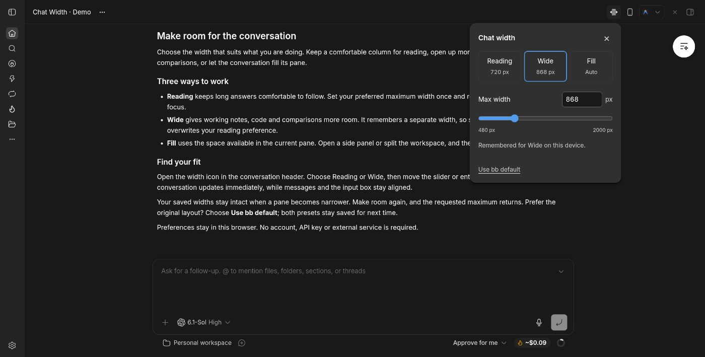

# Chat Width

Choose your chat width. Save two presets or fill the pane.

[](https://github.com/werserk/bb-plugin-chat-width/actions/workflows/ci.yml)
[](LICENSE)



## Your width, one click away

- **Reading / Wide** — two independent presets, adjustable from 480 to 2000 px.
- **Fill** — use the available pane width, including split views.
- **Use bb default** — restore the original layout and keep your presets.

Open the width icon in the conversation header. Choose a mode, then use the slider or pixel field to adjust a preset. Changes preview immediately and are remembered when you finish editing. Messages and the input box stay aligned.

A narrower pane temporarily limits the visible width; your saved maximum stays intact. On compact screens, the controls open in a bottom drawer.

[See the full-width view](docs/screenshots/fill.jpg).

## Install

Requires **BB 0.47.1**. The initial release supports `>=0.47.1 <0.48.0`; broader compatibility is not yet verified.

Install the released Git source:

```bash
bb plugin install 'git:https://github.com/werserk/bb-plugin-chat-width.git@^0.1.0'
```

After the Community submission is merged, search for **Chat Width** in **Settings → Plugins → Community**. The Git source works independently of catalog review.

To disable the plugin and restore BB's layout:

```bash
bb plugin disable chat-width
```

Re-enable it in Installed plugins. To uninstall:

```bash
bb plugin remove chat-width
```

## Private by default

Preferences stay in this browser and synchronize across its same-origin tabs. They do not sync between devices. No account, API key or external service is required. The plugin makes no network requests and does not read or store message bodies.

If browser storage is blocked, changes work for the session and the menu tells you they are not saved. Removing the plugin restores native layout but does not erase the browser's presets.

## Compatibility

New-thread compose and message editors keep BB's layout. This plugin uses public SDK registration APIs and internal conversation layout selectors. A BB markup change may need a plugin update; unknown or ambiguous layouts stay native.

See [compatibility](docs/compatibility.md) and [verification](docs/verification.md) for the tested scope.

## Develop

Use Node.js 24 and npm.

```bash
npm ci
npm run typecheck
npm test
npm run check:sdk
npm run build
```

Install the local source and start live iteration:

```bash
bb plugin install .
bb plugin dev .
```

The SDK and BB build tool are pinned. Production Git installs use the running BB's build tool and the declared runtime dependencies. See [ARCHITECTURE.md](ARCHITECTURE.md) for the module map.

## Report a bug

[Open an issue](https://github.com/werserk/bb-plugin-chat-width/issues/new/choose) with your BB/plugin version, client, mode, and steps to reproduce. Mention split panes or side panels if relevant. No private transcript is needed.

## License

[MIT](LICENSE). Adapted BB overlay primitives retain their [upstream notice](THIRD_PARTY_NOTICES.md).
